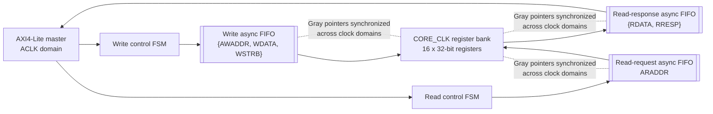
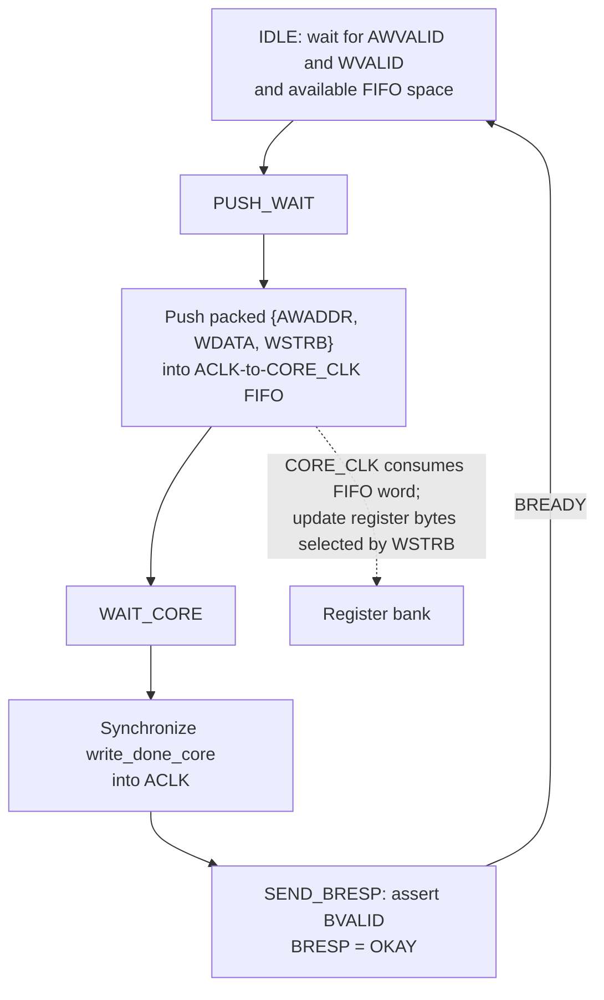
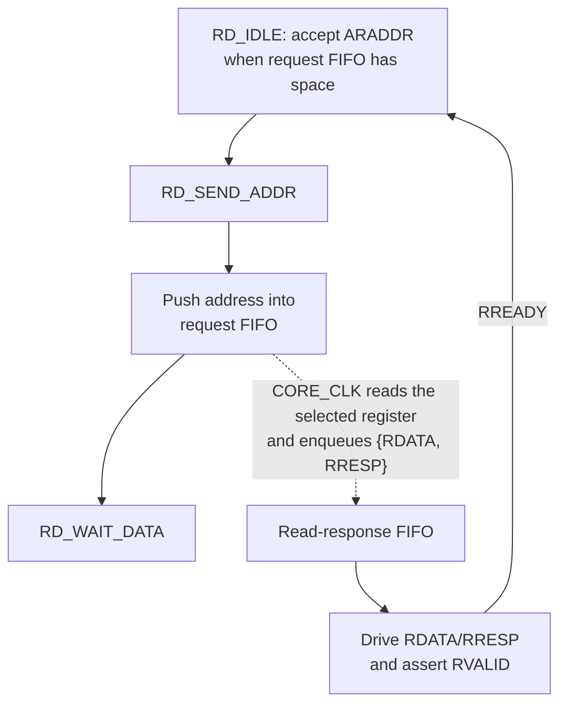
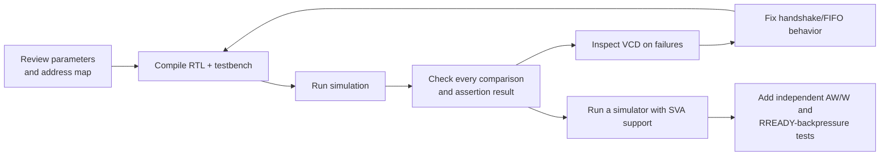

# AXI4-Lite Slave with Clock-Domain-Crossing FIFOs

**Hardening update:** The descriptions and caveats below record the original
implementation. The canonical RTL has since been hardened on `axi-hardening`;
see [AUDIT.md](AUDIT.md), [ASSUMPTIONS.md](ASSUMPTIONS.md), and
[CHANGELOG_AXI_HARDENING.md](CHANGELOG_AXI_HARDENING.md) for current behavior,
known baseline test failures, and verification commands/results.

This project contains a memory-mapped AXI4-Lite slave whose bus interface runs
on `ACLK` while its 16-word register bank runs on `CORE_CLK`. Three asynchronous
FIFOs transfer complete transactions or responses between the clock domains.

> **Implementation note:** This README describes the RTL currently in the
> repository, including its limitations. The design is a useful CDC example,
> but the handshake and FIFO details called out below should be addressed and
> re-verified before production use.

## At a glance

| Item | Current implementation |
| --- | --- |
| AXI data/address widths | 32 bits each by default |
| Write strobe width | `AXI_DATA_WIDTH / 8` (4 bits by default) |
| Register bank | 16 registers, 32 bits each by default |
| FIFO depth | 8 entries by default; configured as a power of two |
| Clock domains | AXI interface on `ACLK`; register bank on `CORE_CLK` |
| FIFO instances | Write request, read request, and read response |
| Testbench clocks | 100 MHz `ACLK`; 75 MHz `CORE_CLK` |
| Simulation | Icarus Verilog; commands below |

## Architecture



The FIFO implementation uses dual-port storage, binary pointers converted to
Gray code, and two-flop synchronizers for Gray pointers. The write FIFO carries
address, data, and byte strobes as one word so those fields cannot become
mispaired in transit. The read path uses one FIFO for the address and another
for the returned data/response.

The existing FIFO architecture illustration is also available at
[async_fifo_architecture.svg](../async_fifo/async_fifo_architecture.svg).

## Write transaction workflow



In the current RTL, the write FSM states are `IDLE`, `PUSH_WAIT`, `WAIT_CORE`,
and `SEND_BRESP`. Both address and data valid must be asserted together for a
write to be accepted; the implementation does not independently buffer AXI's
AW and W channels.

**Important write-path limitation:** `AWREADY` and `WREADY` are asserted in
`IDLE`, but the FIFO push occurs in the following `PUSH_WAIT` state. AXI permits
the master to change payloads after a ready/valid handshake, so the payload
must be captured at acceptance (or otherwise held safely) for general AXI
compliance. Also, `write_done_core` is currently `!wr_empty` (FIFO data
available), not a distinct acknowledgement that the register update has
completed. The response timing should be corrected and verified before relying
on `BVALID` as a write-completion indication.

## Read transaction workflow



Register addresses are byte addresses. The index is selected from address bits
`[5:2]` for the default 16-register bank: `0x00` selects register 0, `0x04`
selects register 1, and `0x3C` selects register 15. Writes update only the byte
lanes whose `WSTRB` bits are set. Unwritten bytes retain their previous values;
registers reset to zero.

**Important read-path limitation:** the read-response FIFO is instantiated
with `rd_en` tied high, rather than consuming a response only on an
`RVALID && RREADY` handshake. Consequently, response retention under
backpressure is not guaranteed by the current implementation. Gate FIFO
consumption on the response handshake and test `RREADY` stalls before using
this path as a general AXI4-Lite slave.

The core-side logic prioritizes a pending write over a pending read when both
are available in the same `CORE_CLK` cycle.

## AXI4-Lite interface

| Channel | Signals |
| --- | --- |
| Write address | `AWADDR`, `AWVALID`, `AWREADY` |
| Write data | `WDATA`, `WSTRB`, `WVALID`, `WREADY` |
| Write response | `BRESP`, `BVALID`, `BREADY` |
| Read address | `ARADDR`, `ARVALID`, `ARREADY` |
| Read data/response | `RDATA`, `RRESP`, `RVALID`, `RREADY` |

The response code is currently always `2'b00` (`OKAY`). The default register
selection uses word-aligned byte addresses. The default 32-bit data width
implies four byte strobes.

## Source files and outputs

- [axi4lite_slave_top.sv](../axi4lite_slave_top.sv) — AXI interface, channel
  state machines, register bank, FIFO wiring, and conditionally compiled SVA.
- [async_fifo.sv](../async_fifo/rtl/async_fifo.sv) — asynchronous FIFO and
  supporting RAM, pointer, and synchronizer modules; reused by the design.
- [tb_axi4lite_slave_top.sv](../tb_axi4lite_slave_top.sv) — testbench and
  waveform dump setup.
- [PROJECT_REFERENCE.md](PROJECT_REFERENCE.md) — consolidated project record
  assembled from the existing completion and summary documents.
- [async_fifo_architecture.svg](../async_fifo/async_fifo_architecture.svg) —
  existing FIFO illustration.
- `axi4lite_tb.vvp` — compiled simulation executable (generated).
- `tb_axi4lite_slave_top.vcd` — waveform dump (generated).

The design exposes `AXI_ADDR_WIDTH`, `AXI_DATA_WIDTH`, and `FIFO_DEPTH`
parameters. `FIFO_DEPTH` must be a power of two because its FIFO address width
is derived with `$clog2(FIFO_DEPTH)`.

## Simulate

From the project root, compile and run with Icarus Verilog:

```sh
iverilog -g2012 -Wall -Wno-timescale -o axi4lite_tb.vvp async_fifo/rtl/async_fifo.sv axi4lite_slave_top.sv tb_axi4lite_slave_top.sv
vvp axi4lite_tb.vvp
```

The testbench generates `tb_axi4lite_slave_top.vcd` in the current working
directory. Open that waveform in a VCD viewer to inspect the independent clocks,
AXI handshakes, and FIFO-driven transfers.

The test sequence exercises writes to registers 0, 4, and 15, a partial-byte
write, back-to-back writes, read-back, and a write followed by a read of the
same address. The source completion notes report that these tests passed.
However, the testbench prints `ERROR` messages rather than terminating with a
failing status for mismatches, and the concurrent SVA block is excluded when
compiled by Icarus (`__ICARUS__`). Treat the printed results as the evidence;
an exit code of zero alone does not establish that every comparison passed.
The testbench also does not establish correct behavior under arbitrary
`RREADY` backpressure or independent AW/W arrival.

In a bounded documentation-validation run in this workspace, Icarus
compilation completed but `vvp` did not finish within 10 seconds. Therefore,
the historical pass claims have not been independently confirmed by this run.

## Suggested engineering workflow



1. Review the RTL and FIFO parameters before integration.
2. Compile and run the testbench using the commands above.
3. Inspect each test comparison and waveform; do not use process success alone
   as a correctness signal.
4. Before production use, address the write-payload capture and write
   acknowledgement semantics, gate read-response consumption on the AXI
   handshake, and add tests for independent AW/W arrival and response
   backpressure.
5. Run the SVA checks in a simulator that supports the concurrent assertion
   constructs used by the RTL.

## Assertions

When not compiled with `__ICARUS__`, the RTL contains assertions for address,
data, and response stability while `VALID` is stalled, and for FIFO pushes
while full. These are useful checks, but the assertions currently present are
not a substitute for the missing independent-channel and backpressure tests
described above.

## Project status

The completion notes date the original implementation to **October 9, 2026**
and describe the deliverables as complete. The current README records the
implementation caveats visible in the RTL so that reported completion status
is not mistaken for signoff of all AXI4-Lite corner cases.
